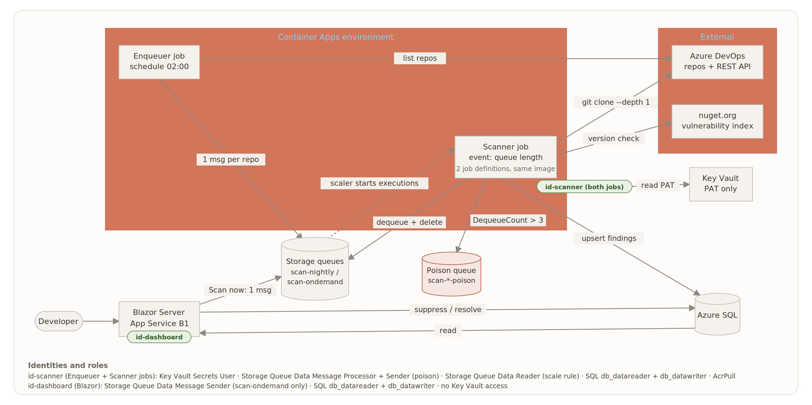

# Repo Scanner

A .NET 10 console app that scans Blacklight's Azure DevOps repositories for hard-coded secrets, vulnerable NuGet packages and insecure code patterns, and stores the findings in Azure SQL for the Code Repo Analysis Dashboard. It runs as an Azure Container Apps Job: it processes the queued repositories and exits.

> Work in progress. This README grows as each feature is added.

## Architecture



The enqueuer job puts one message per repository on a storage queue. The scanner job starts when messages arrive, clones each repository once, runs the secret, package and code-pattern scanners, and upserts the findings into Azure SQL. The Blazor dashboard reads the findings and lets developers suppress or resolve them. This repository contains the scanner job and the shared data library.

## Project dependencies

```
RepoScanner.Scanner ──► RepoScanner.Data ──► RepoScanner.Core
         │                                          ▲
         └──────────────────────────────────────────┘
```

- **Core** depends on nothing, so it can be used by any project (including the dashboard) without pulling in databases, Azure or Roslyn.
- **Data** uses Core's types to store them in SQL.
- **Scanner** uses both.
- References only point towards Core. A reference the other way creates a loop, which the build rejects (`MSB4006: circular dependency`).

## Prerequisites

- .NET 10 SDK (the version is pinned in `global.json`)
- Git

## Build and run

```bash
dotnet build RepoScanner.sln
```

```bash
dotnet run --project src/RepoScanner.Scanner
```

```bash
dotnet test RepoScanner.sln
```

`dotnet test` also measures line coverage (coverlet) and fails if Core or Scanner drop below 80%. Data's coverage is reported but not enforced. Reports are written to `tests/<project>/TestResults/coverage/coverage.cobertura.xml` (git-ignored).

The coverage table per project is hidden by the .NET terminal logger in an interactive terminal. To see it, and each test by name:

```bash
dotnet test --tl:off --logger "console;verbosity=normal"
```

## Configuration

Settings are read from `appsettings.json`, then `appsettings.{Environment}.json`, then environment variables, then command-line arguments. Later sources win. `dotnet run` uses the `Development` environment (`Properties/launchSettings.json`), which points at local Azurite.

The app checks its settings when it starts and refuses to run if any are missing or invalid.

| Setting | Required | Default | Notes |
|---|---|---|---|
| `Scanner:Queue:Name` | Yes | | `scan-nightly` or `scan-ondemand`. Lowercase letters, numbers and hyphens, 3 to 63 characters |
| `Scanner:Queue:ConnectionString` | One of these two | | Local only: `UseDevelopmentStorage=true` (Azurite) |
| `Scanner:Queue:ServiceUri` | One of these two | | Azure only, used with managed identity |
| `Scanner:Queue:PoisonQueueName` | | `<Name>-poison` | Where failing messages are moved. One per lane, e.g. `scan-nightly-poison` (ADR-013) |
| `Scanner:Queue:MaxDequeueCount` | | `3` | Attempts before a message is moved to the poison queue (ADR-013) |

As environment variables, `:` becomes `__`, for example:

```powershell
$env:Scanner__Queue__Name = "scan-ondemand"
```

Further settings (database, Azure DevOps, execution limits) are added with the features that use them.

## Exit codes

The Container Apps Job reads the exit code to decide whether an execution succeeded.

| Code | Meaning |
|---|---|
| `0` | Success, or nothing to do |
| `1` | Unexpected failure during the run (logged with the full exception) |
| `2` | Invalid configuration: the scanner did not start (logged as one line listing what is wrong) |

To see exit code 2 locally, run without the Development settings:

```bash
dotnet run --project src/RepoScanner.Scanner --no-launch-profile
```

## Repository layout

```
global.json               pins the .NET SDK version
Directory.Build.props     build settings shared by every project
Directory.Packages.props  every NuGet package version, set once (Central Package Management)
.editorconfig             code style rules, enforced during build
RepoScanner.sln           solution file
docs/
  adr/                    architecture decision records (index in docs/adr/README.md)
  images/                 diagrams used in the documentation
src/
  RepoScanner.Core/       domain types and contracts shared by every project (no dependencies)
  RepoScanner.Data/       EF Core database access, shared with the dashboard
  RepoScanner.Scanner/    the console app
tests/
  RepoScanner.Core.Tests/     NUnit tests for Core
  RepoScanner.Data.Tests/     NUnit tests for Data
  RepoScanner.Scanner.Tests/  NUnit tests for Scanner
```

## Conventions

The reasons behind the design are recorded as [architecture decision records](docs/adr/README.md).

- Work happens on `feature/<work-item-id>-<short-name>` branches created from `develop`.
- `develop` and `main` only change through pull requests linked to an Azure Boards work item.
- Implicit usings are off: every file lists its own `using` directives.
- No top-level statements: the entry point is `Program.Main`.
