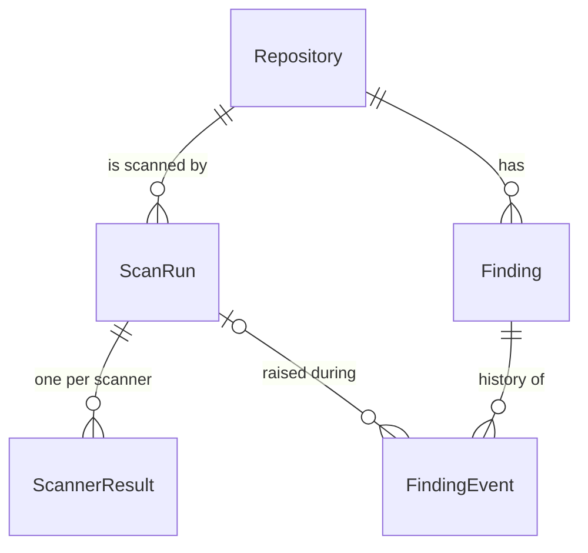

# Issue 2: Data model and persistence (design)

- **Status:** Draft, for review
- **Date:** 2026-09-24
- **Work item:** Issue 2, #7 (tasks #8 to #13)
- **Branch:** `feature/7-data-model-and-persistence`

## Purpose

`Finding` is the contract between the scanner, which writes findings, and the Blazor dashboard, which reads, suppresses and resolves them. Settling the data model before any scanner exists avoids rework on both sides.

Task #8 refers to section 3.5 of *Code Repo Analysis Dashboard, Spike Findings & ADRs v2* for the entities. That section is not available, so this document is the data model. It starts from the entity relationship diagram drawn from the ADRs and the board, and records each decision made while designing it.

## Success criteria

From Issue 2 (#7) and task #13:

1. A fresh SQL Server database stands up from the migrations alone, on the local SQL Server and on Azure SQL Database.
2. The repository round-trip tests pass.
3. No call that creates, migrates or deletes the database (`Migrate()`, `EnsureCreated()`, `EnsureDeleted()` and their variants) exists in Scanner or Data, and a test fails the build if one is added.

## Decisions

| # | Question | Decision | Reason |
|---|---|---|---|
| 1 | Where the model comes from | The ERD built from the ADRs and board | Section 3.5 is not available |
| 2 | A `Repository` table? | Yes | The dashboard's page of repositories reads it with LINQ; names are stored once |
| 3 | Per-scanner results | A separate `ScannerResult` table | The three scanners share one interface (ADR-009), so results are a list; a new scanner needs no schema change |
| 4 | Primary key type | `int` identity on every table | Azure SQL Basic is capped at 2 GB (ADR-015), far below 2.1 billion rows |
| 5 | Scan history | Every scan run is kept | ADR-012 and ADR-013 depend on scan history; findings are updated in place |
| 6 | Where repository interfaces live | Contracts in Core, implementations in Data | Business logic in Core can use them; Core cannot reference Data |
| 7 | "Repository" table vs repository pattern | Keep the name `Repository`; no separate interface for it | `IScanRunRepository.StartRunAsync` upserts it with the scan run |
| 8 | Enum storage | Text, for example `'Open'` | Readable in SSMS; reordering C# enum values cannot change stored meaning |
| 9 | Connection string for `dotnet ef` | User environment variable `Scanner__Database__ConnectionString` | No connection string in code (ADR-007) |
| 10 | Where this document lives | `docs/design/` | Next to `docs/adr/`, part of the Issue 2 pull request |

Also decided while setting up the local database: the local database is the SQL Server 2022 Express instance installed on the developer machine (`.\SQLEXPRESS`), reached with Windows authentication, not SQL Server in Docker. This is recorded as an amendment to ADR-017 in the same pull request.

## Project layout

```
src/RepoScanner.Core/                  no packages
  Entities/        Repository, ScanRun, ScannerResult, Finding, FindingEvent
  Enums/           ScanRunStatus, ScanTrigger, ScannerType, ScannerStatus,
                   FindingStatus, Severity, FindingEventType
  Persistence/     IScanRunRepository, IFindingRepository,
                   RepositoryDetails, ScanRunCompletion, FindingChanges

src/RepoScanner.Data/                  Microsoft.EntityFrameworkCore.SqlServer
                                       Microsoft.EntityFrameworkCore.Design (PrivateAssets=all)
  ScannerDbContext.cs
  ScannerDbContextFactory.cs           design-time factory for dotnet ef
  Configurations/  one IEntityTypeConfiguration<T> per entity
  Repositories/    ScanRunRepository, FindingRepository
  Migrations/      InitialCreate, generated by dotnet ef

tests/RepoScanner.Data.Tests/          + Microsoft.EntityFrameworkCore.Sqlite
tests/RepoScanner.Scanner.Tests/       + the task #13 test
.config/dotnet-tools.json              pins dotnet-ef
```

- Package versions are set once in `Directory.Packages.props`: all EF Core packages and `dotnet-ef` at **10.0.12**, the same version as `Microsoft.Extensions.Hosting`.
- `Microsoft.EntityFrameworkCore.Design` is marked `PrivateAssets="all"`, so the dashboard does not inherit it by referencing Data.
- The Scanner project does not change in Issue 2. It starts using the database in Issue 3 (task #71).
- Entities are `sealed` classes with public getters and setters and no attributes. They are classes, not records, because an entity keeps its identity while its values change.
- Code follows ADR-021: explicit `using` directives, block-scoped namespaces, explicit types, and a comment explaining the reason for anything that is not obvious.
- `SkipAutoProps` is set to `true` in `Directory.Build.props`, so the 80% coverage gate on Core measures logic, not the accessors of auto-properties on entities.

## Entity relationship diagram



## Enums

All stored as `varchar(20)` text. The longest values, `PartiallyCompleted` and `SuppressionExpired`, are 18 characters.

| Enum | Values |
|---|---|
| `ScanRunStatus` | `Running`, `Completed`, `PartiallyCompleted`, `Failed` |
| `ScanTrigger` | `Nightly`, `OnDemand` |
| `ScannerType` | `Secret`, `Package`, `CodePattern` |
| `ScannerStatus` | `Succeeded`, `Failed` |
| `FindingStatus` | `Open`, `Resolved`, `Suppressed` |
| `Severity` | `Low`, `Medium`, `High`, `Critical` |
| `FindingEventType` | `Detected`, `Resolved`, `Reopened`, `Suppressed`, `SuppressionExpired` |

## Entities

Types are SQL Server types. "Null" marks an optional column, which is nullable in C# as well (`string?`, `int?`, `DateTime?`). Required strings default to `string.Empty`, as in `QueueOptions`. Every `Id` is an `int` identity primary key.

Dates are `DateTime` values in UTC, stored as `datetime2`, and every date column name ends in `Utc`. `DateTimeOffset` is not used because SQLite, which runs the repository tests, cannot sort by it.

`varchar` is used for values that only ever contain ASCII letters and digits (hashes, commit SHAs, rule IDs, enums); `nvarchar` for anything a person might type.

### Repository

One row per Azure DevOps repository. The scanner inserts it the first time the repository is scanned and updates it when the name or branch changes. Growth: one row per repository, about 40.

| Column | Type | Null | Notes |
|---|---|---|---|
| `Id` | int | | primary key |
| `AzureDevOpsId` | uniqueidentifier | | Azure DevOps' own repository ID, unique |
| `ProjectName` | nvarchar(256) | | |
| `Name` | nvarchar(256) | | |
| `DefaultBranch` | nvarchar(256) | | as Azure DevOps returns it, for example `refs/heads/main` |

Navigation: `ScanRuns`, `Findings`.

### ScanRun

One new row per scan, never overwritten. Growth: about 15,000 rows a year at 40 repositories scanned nightly.

| Column | Type | Null | Notes |
|---|---|---|---|
| `Id` | int | | primary key |
| `RepositoryId` | int | | foreign key to `Repository` |
| `TriggerType` | varchar(20) | | `ScanTrigger`; not named `Trigger`, which is a reserved word in SQL Server |
| `Status` | varchar(20) | | `ScanRunStatus` |
| `CommitSha` | varchar(40) | Null | empty if the clone failed |
| `CorrelationId` | uniqueidentifier | | from the queue message (#62) |
| `StartedUtc` | datetime2 | | |
| `CompletedUtc` | datetime2 | Null | empty while `Running` |
| `NewCount` | int | | findings added by this run; 0 until the run completes |
| `ReopenedCount` | int | | findings reopened by this run; 0 until the run completes |
| `ResolvedCount` | int | | findings resolved by this run; 0 until the run completes |
| `ErrorMessage` | nvarchar(max) | Null | set when the run failed (ADR-013) |

Navigation: `Repository`, `ScannerResults`.

### ScannerResult

Up to three rows per scan run, one for each scanner that ran. Task #25 uses it to skip auto-resolving the findings of a scanner that failed; task #63 uses its timings and counts.

| Column | Type | Null | Notes |
|---|---|---|---|
| `Id` | int | | primary key |
| `ScanRunId` | int | | foreign key to `ScanRun` |
| `ScannerType` | varchar(20) | | `ScannerType` |
| `Status` | varchar(20) | | `ScannerStatus` |
| `FindingCount` | int | | |
| `DurationMs` | int | | |
| `ErrorMessage` | nvarchar(max) | Null | set when the scanner failed |

Navigation: `ScanRun`.

### Finding

One row per unique problem in a repository, kept across scans and updated in place. A new row is added only when a new problem appears. The raw value of a secret is never stored.

| Column | Type | Null | Notes |
|---|---|---|---|
| `Id` | int | | primary key |
| `RepositoryId` | int | | foreign key to `Repository` |
| `Fingerprint` | varchar(64) | | SHA-256 in hex; excludes the line number (#27) |
| `ScannerType` | varchar(20) | | `ScannerType` |
| `RuleId` | varchar(10) | | `SEC001`, `PKG001`, `CP001` and so on |
| `Severity` | varchar(20) | | `Severity` |
| `FilePath` | nvarchar(1024) | | path within the repository |
| `LineNumber` | int | Null | for display only |
| `Message` | nvarchar(1000) | | |
| `MaskedPreview` | nvarchar(200) | Null | secret findings only |
| `SecretHash` | varchar(64) | Null | secret findings only, SHA-256 in hex (#18) |
| `PackageName` | nvarchar(256) | Null | package findings only |
| `PackageVersion` | nvarchar(64) | Null | package findings only |
| `AdvisoryUrl` | nvarchar(2048) | Null | package findings only (#46) |
| `Status` | varchar(20) | | `FindingStatus` |
| `FirstSeenUtc` | datetime2 | | |
| `LastSeenUtc` | datetime2 | | |
| `ResolvedUtc` | datetime2 | Null | |
| `SuppressedUntilUtc` | datetime2 | Null | empty on a suppressed row means permanent (ADR-019) |
| `SuppressedBy` | nvarchar(256) | Null | |
| `SuppressionReason` | nvarchar(1000) | Null | required when `Status` is `Suppressed` (ADR-019) |

Navigation: `Repository`, `Events`.

### FindingEvent

The history of a finding. Nothing is deleted, so this is the audit trail ADR-019 asks for.

| Column | Type | Null | Notes |
|---|---|---|---|
| `Id` | int | | primary key |
| `FindingId` | int | | foreign key to `Finding` |
| `ScanRunId` | int | Null | foreign key to `ScanRun`; empty for actions taken in the dashboard |
| `EventType` | varchar(20) | | `FindingEventType` |
| `OccurredUtc` | datetime2 | | |
| `Actor` | nvarchar(256) | | `scanner`, or the developer's sign-in name |
| `Detail` | nvarchar(1000) | Null | for example the suppression reason |

Navigation: `Finding`, `ScanRun`.

## Fluent API configuration

One `IEntityTypeConfiguration<T>` class per entity in `Data/Configurations/`, loaded by `ScannerDbContext.OnModelCreating` with `ApplyConfigurationsFromAssembly`. Everything in the tables above is configured explicitly rather than left to conventions: keys, lengths, `IsUnicode(false)` on `varchar` columns, requiredness and enum conversions.

**Tables** are named explicitly with `ToTable`: `Repositories`, `ScanRuns`, `ScannerResults`, `Findings`, `FindingEvents`.

**Relationships:** every foreign key uses `DeleteBehavior.Restrict`, so deleting a row never deletes other rows. Nothing is deleted (ADR-019), and SQL Server would reject cascading deletes anyway, because `FindingEvents` can be reached from `Repositories` by two paths.

**Indexes:**

| Table | Index | Used by |
|---|---|---|
| `Repositories` | unique `AzureDevOpsId` | the upsert in `StartRunAsync` |
| `ScanRuns` | `(RepositoryId, Status)` | "is a scan already running for this repository?" (#33) |
| `ScanRuns` | `(RepositoryId, StartedUtc)` | the dashboard's latest scan per repository |
| `ScannerResults` | unique `(ScanRunId, ScannerType)` | one result per scanner per run |
| `Findings` | unique `(RepositoryId, Fingerprint)` | at-least-once delivery never creates a duplicate (ADR-004) |
| `Findings` | `(RepositoryId, Status)` | open findings, for the reconciler and the dashboard |
| `FindingEvents` | `(FindingId, OccurredUtc)` | a finding's history in order |

**Check constraint:** `CK_Findings_SuppressionReason` with `[Status] <> 'Suppressed' OR [SuppressionReason] IS NOT NULL`, so the database rejects a suppression without a reason, whichever application writes it.

**Enums:** `.HasConversion<string>()` with `HasMaxLength(20)` and `IsUnicode(false)`.

**No database defaults:** the code sets every value, including dates, so SQLite and SQL Server behave the same.

**No concurrency tokens:** the scanner writes at 02:00 and the dashboard is used in the daytime, so two changes to one finding at the same moment are unlikely. A `rowversion` column can be added if that changes.

## Repository contracts

Contracts in `Core/Persistence/`, EF Core implementations in `Data/Repositories/`. The schema is complete in the first migration, so the dashboard can be built against it; repository methods are added only when a feature uses them. Issue 2 creates these four:

```csharp
public interface IScanRunRepository
{
    // Adds or updates the Repository row (matched on AzureDevOpsId) and adds a Running ScanRun, in one SaveChanges
    Task<ScanRun> StartRunAsync(RepositoryDetails repository, ScanTrigger trigger,
        Guid correlationId, DateTime startedUtc, CancellationToken cancellationToken);

    // Sets the final status, commit, counts and error, and adds the ScannerResult rows, in one SaveChanges
    Task CompleteRunAsync(int scanRunId, ScanRunCompletion completion, CancellationToken cancellationToken);
}

public interface IFindingRepository
{
    // Every finding for the repository, whatever its status: the reconciler reopens resolved
    // findings and leaves suppressed ones alone
    Task<IReadOnlyList<Finding>> GetByRepositoryAsync(int repositoryId, CancellationToken cancellationToken);

    // Adds new findings, updates changed ones and adds their events, in one SaveChanges
    Task SaveChangesAsync(FindingChanges changes, CancellationToken cancellationToken);
}
```

The input types are `sealed record`s in `Core/Persistence/`:

- `RepositoryDetails`: `AzureDevOpsId`, `ProjectName`, `Name`, `DefaultBranch`.
- `ScanRunCompletion`: `Status`, `CommitSha`, `CompletedUtc`, `NewCount`, `ReopenedCount`, `ResolvedCount`, `ErrorMessage`, and `ScannerResults` as a list of `ScannerResult`.
- `FindingChanges`: `NewFindings`, `UpdatedFindings` and `NewEvents`.

Rules for the implementations:

- **One `SaveChanges` per method.** EF Core runs each `SaveChanges` in a transaction, so a method saves everything or nothing. ADR-013 deletes the queue message only after the upsert commits, so a half-saved scan must never happen. No explicit transactions are used, which also keeps the repositories compatible with the SQL retry policy added in task #71.
- **Reads and writes only.** Only EF Core queries and `SaveChanges`, which produce `SELECT`, `INSERT` and `UPDATE`: all within `db_datareader` and `db_datawriter` (ADR-008). No raw SQL, no stored procedures, no DDL, and no `DELETE`.
- **Two scans adding the same new repository at once:** the unique index on `AzureDevOpsId` makes the second insert fail rather than create a duplicate, and the queue retries the message. In practice it cannot happen: a repository that has never been scanned is not in the table, so it cannot be picked for "Scan now".

## Local database and migrations (task #10)

1. `dotnet tool restore` installs the pinned `dotnet-ef` from `.config/dotnet-tools.json`.
2. Set the connection string once as a user environment variable, then open a new terminal:
   ```powershell
   [Environment]::SetEnvironmentVariable('Scanner__Database__ConnectionString', 'Server=.\SQLEXPRESS;Database=RepoScanner;Trusted_Connection=True;TrustServerCertificate=True', 'User')
   ```
   `ScannerDbContextFactory` reads this variable. If it is missing, the factory stops with a message naming the variable and pointing to the README. The message does not contain a connection string, so none exists in the code. The scanner reads the same variable at run time from Issue 3 onwards (task #71).
3. `dotnet ef migrations add InitialCreate --project src/RepoScanner.Data --startup-project src/RepoScanner.Data`
4. `dotnet ef database update --project src/RepoScanner.Data --startup-project src/RepoScanner.Data` creates the `RepoScanner` database on `.\SQLEXPRESS` with the five tables and `__EFMigrationsHistory`. The database is not created by hand: building it from nothing is success criterion 1.
5. `dotnet ef migrations script --idempotent --project src/RepoScanner.Data --startup-project src/RepoScanner.Data` must produce a script. It is the command the pipeline will run against Azure SQL (ADR-006), and it does not connect to any database. It still builds the context through the factory, so the pipeline sets the same variable to the Azure SQL connection string, which uses Entra authentication and holds no password (Issue 12, task #73).

The generated migration files carry an `<auto-generated>` header, so the code style rules skip them; the build must still finish with zero warnings.

The README gains a section on setting the environment variable and applying migrations, linking to ADR-006 and ADR-017.

## Testing

**Data.Tests** uses SQLite in memory: each test opens its own connection to a new in-memory database, with foreign keys enforced, and builds the schema with `EnsureCreated()`. Test projects may call `EnsureCreated()`; the rule only covers Scanner and Data.

The configuration tests belong to task #9, because they test the Fluent API code written there:

- **Round trip:** every column of every entity is saved, then read back through a new `DbContext`, which proves the value came from the database and not from EF Core's change tracker.
- **Database rules:** a duplicate `(RepositoryId, Fingerprint)`, a duplicate `AzureDevOpsId`, a duplicate `(ScanRunId, ScannerType)`, a `Suppressed` finding without a reason, and deleting a repository that still has findings are each rejected. The same fingerprint in two different repositories is accepted, which proves the uniqueness is per repository.
- **Enums as text:** a raw SQL read of `Findings.Status` returns `'Open'`, not `0`.
- **Design-time factory:** with the variable unset it throws an error naming `Scanner__Database__ConnectionString`; with it set, it builds a SQL Server context that uses that value.

The repository tests belong to task #12 (with #11):

- **Repositories:** `StartRunAsync` adds a new repository, updates a renamed one and creates a `Running` run; `CompleteRunAsync` stores the final status and scanner results; `GetByRepositoryAsync` returns findings of every status for that repository only; `SaveChangesAsync` saves new findings, updates and events together.

**What SQLite cannot show:** it ignores column lengths, `varchar` versus `nvarchar`, and non-unique indexes, so those are confirmed on SQL Server by task #10.

Each database rule and repository method is written test first: a failing test, then the code that makes it pass.

**Scanner.Tests (task #13):** a test reads the compiled `RepoScanner.Scanner.dll` and `RepoScanner.Data.dll` with `System.Reflection.Metadata` and fails if either references a method that changes the schema: `RelationalDatabaseFacadeExtensions.Migrate` and `MigrateAsync`, `IMigrator.Migrate` and `MigrateAsync`, and `DatabaseFacade.EnsureCreated`, `EnsureCreatedAsync`, `EnsureDeleted` and `EnsureDeletedAsync`. Every method an assembly calls in another assembly is listed in its metadata, whatever the source looks like, so comments and strings cannot cause a false alarm and formatting cannot hide a call. (Agreed on 2026-09-25 in place of searching the source files.) It is shown failing once, with a call added on purpose, before that call is removed.

**Coverage:** Core and Scanner stay at 80% or more; Data is reported but not enforced (ADR-021).

## Order of work

One task at a time, stopping after each for review and a commit ending in its task number (ADR-020):

1. **#8** Enums and entities in Core, and `SkipAutoProps`.
2. **#9** `ScannerDbContext`, the five configuration classes and `ScannerDbContextFactory`, test first with the SQLite configuration tests and the factory tests.
3. **#10** `InitialCreate` migration, applied to `.\SQLEXPRESS`, and the idempotent script checked.
4. **#12 with #11** Repository contracts and implementations, test first on SQLite, reusing the test database helper from #9.
5. **#13** The no-migrate test and the README migrations section.

The ADR-017 amendment (local SQL Server, not Docker) goes in the same pull request.

## Not in Issue 2

| Item | Where it is on the board |
|---|---|
| `DatabaseOptions`, registering the DbContext and repositories in Scanner | Issue 3, task #71 |
| SQL retry policy on the scanner's connection (ADR-015) | Issue 3, task #71 |
| "Is a scan already running?" query and stale run takeover | Issue 5, task #33 |
| Reconciliation rules | Issue 4, task #24 |
| SQL login for the scanner container | Issue 9, task #70 |
| Pipeline Migrate stage (ADR-006) | Issue 12 (#72), task #73 |
| Concurrency tokens | Deliberately not planned; see Fluent API configuration |
| The dashboard | Outside this repository and this epic |

## Known limitations

- SQLite and SQL Server differ (lengths, some types), so the SQLite tests prove the mapping and repository logic, and the migration applied to SQL Server Express proves the SQL Server schema.
- `SecretHash` is an unsalted SHA-256, so a short secret could be guessed by hashing candidates. Task #18 records this in its own ADR.
- A repository appears in the `Repositories` table, and so on the dashboard, only once its first scan has started.
